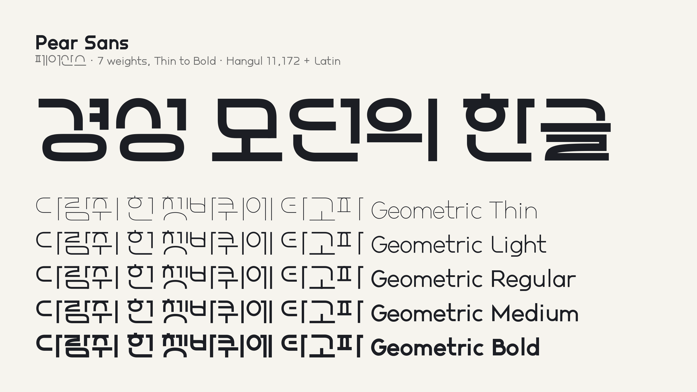

# Pear Sans



Pear Sans (페어산스) is a geometric Hangul typeface inspired by the lettering of 1920s and 1930s Gyeongseong (Seoul). In that era, Art Deco and Western modern design reached Korea, and magazine and advertising designers drew Hangul as if with a ruler and compass. Pear Sans starts from those letters and redraws them for today: a simple skeleton of circles and straight lines, with one curve and the placement of each stroke carrying the period's geometric charm.

The family comes in 7 weights from Thin to Bold, and as a variable font with a weight axis (100 to 700). It covers all 11,172 modern Hangul syllables, the Google Fonts Latin Core character set, figures and punctuation.

Designed by Heebae Lee (Pear Type Foundry).

## Building

Fonts are built with [gftools builder](https://github.com/googlefonts/gftools):

```
python3 -m venv venv
. venv/bin/activate
pip install -r requirements.txt
cd sources
gftools builder config.yaml
```

The built fonts are written to `fonts/variable` and `fonts/ttf`.

## License

This Font Software is licensed under the SIL Open Font License, Version 1.1. See [OFL.txt](OFL.txt).

## 페어산스

1920~30년대 경성의 잡지와 광고 도안에 쓰인 기하학적인 한글 레터링에서 출발한 폰트예요. Thin부터 Bold까지 7가지 굵기와 가변 폰트, 한글 11,172자와 라틴 문자를 지원해요. SIL 오픈 폰트 라이선스 1.1로 누구나 자유롭게 쓸 수 있어요.
